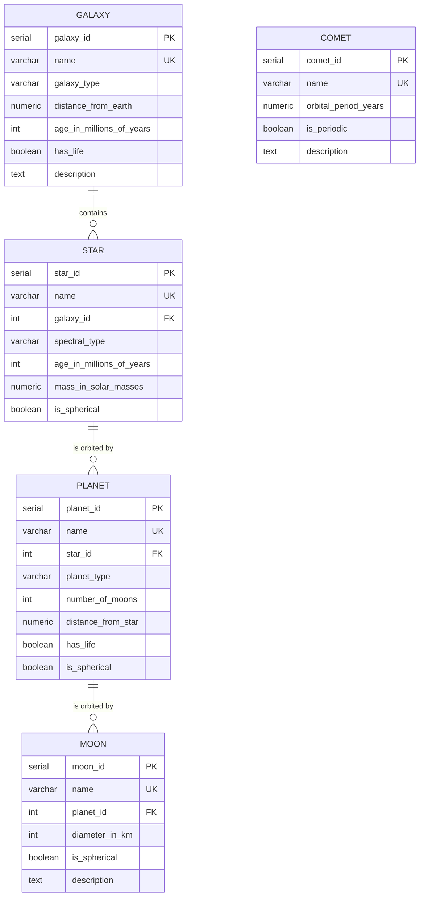

# Celestial Bodies Database

A relational PostgreSQL database modeling the universe — galaxies, stars, planets, moons and comets — built as part of freeCodeCamp's **Relational Database** certification.

## Schema



| Table  | Rows | Notes |
|--------|------|-------|
| galaxy | 6    | Milky Way, Andromeda, Magellanic Clouds, M87… |
| star   | 6    | Sun, Proxima Centauri, TRAPPIST-1, Betelgeuse… |
| planet | 12   | Solar System + Proxima and TRAPPIST-1 exoplanets |
| moon   | 21   | Major moons of Earth, Mars, Jupiter, Saturn, Uranus, Neptune |
| comet  | 3    | Standalone table (Halley, Hale-Bopp, Encke) |

## Design choices

- **Auto-incrementing primary keys** (`SERIAL`) named `<table>_id`.
- **Foreign keys** keep the hierarchy consistent: every moon belongs to a planet, every planet to a star, every star to a galaxy.
- **Constraints**: `name` is `NOT NULL` and `UNIQUE` in every table; foreign keys are `NOT NULL`.
- **Data types** matched to the data: `INT` for counts and ages, `NUMERIC` for precise measurements (distances, masses), `BOOLEAN` for flags, `TEXT` for free-form descriptions.

## How to run

```bash
psql -U postgres < universe.sql
```

Then connect with `\c universe`.

## Example queries

```sql
-- Moons per planet
SELECT p.name AS planet, COUNT(m.moon_id) AS moons_in_db
FROM planet p
LEFT JOIN moon m ON m.planet_id = p.planet_id
GROUP BY p.name
ORDER BY moons_in_db DESC;

-- Full hierarchy for a moon
SELECT m.name AS moon, p.name AS planet, s.name AS star, g.name AS galaxy
FROM moon m
JOIN planet p ON p.planet_id = m.planet_id
JOIN star   s ON s.star_id   = p.star_id
JOIN galaxy g ON g.galaxy_id = s.galaxy_id
WHERE m.name = 'Titan';
```

## Tech

PostgreSQL · SQL (DDL & DML) · psql
